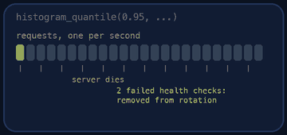
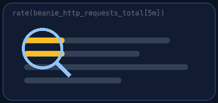

<p align="center"></p>

| | |
|-|-|
| **Time** | 90-105 min |
| **Cost** | free on your own machine |
| **You need** | Docker, Python 3 and a terminal (on Windows use WSL) |

## How this lab works

1. **Fork** this repository to your own GitHub account (button at the top right).
2. Clone **your fork** in your Ubuntu environment (WSL on Windows, your OrbStack machine on Mac).
3. Read the lab below (the same text is in [`LAB.md`](LAB.md)) and follow the mission.
4. Answer the questions in [`SUBMISSION.md`](SUBMISSION.md). Where a question asks for output, paste it in a code block. No screenshots needed.
5. Commit and push. Open the **Actions** tab of your fork (click *I understand my workflows, go ahead and enable them* the first time). The **Lab check** shows what is still missing.
6. When the check is green, **submit the URL of your fork** in the course platform.

> [!NOTE]
> The check only looks at your answers and any files the lab asks you to commit. Your instructor reads your work and may ask you to explain any line.

<p align="center"></p>

## 🎬 The situation

<p align="center"></p>

```text
GYM CARD - Beanie, the night of 2026-01-01
Rounds  : 12 questions, easy to brutal
Scoring : each correct answer is checked against the real data (1% tolerance)
Goal    : 12 / 12, then explain the night in plain words
Coach   : none. The on-call engineer left a note that says "fixed, was slow".
```

Between three and six in the morning something went wrong with Beanie. Six hours of metrics from five services sit in a local Prometheus, and the team lead wants four answers by lunch: **what happened, when, how bad, and could it happen tonight?** Reading a time series database is a skill, and skills come from repetition, so this is a gym. Every question tells you *what* to compute and *when*; finding *how* in PromQL is the workout.

> [!IMPORTANT]
> **Your mission**
> - Start the recorded night in a local Prometheus
> - Answer twelve questions with PromQL: rates, ratios, percentiles, the worst offender, a counter that reset, a memory leak and a prediction
> - Read the story the numbers tell and write it down
> - Tear down and prove it

**Time:** 90-105 min | **Cost:** free | **You need:** Docker, Python 3 with PyYAML (`python3 -m pip install pyyaml`) and a terminal. On Windows use WSL.

<p align="center"></p>

## Warm-up - Start the night

Fork this repository, clone your fork and run:

```bash
./setup.sh
```

It generates six hours of metrics (the same every time), loads them into a time-series database with `promtool tsdb create-blocks-from openmetrics` (this is how you **backfill** historical data into Prometheus) and starts a Prometheus on http://localhost:9099. Nothing is being scraped: all the data is from the past. Read `gym/gen_incident.py` only if you must; the point is to find the story in the numbers, not in the generator.

Open http://localhost:9099. The recorded night starts at **2026-01-01 00:00:00 UTC**. Because the data is old, you must tell the UI *when* to ask: in the **Table** tab, set the **Evaluation time** to the moment given for each question (for example `2026-01-01 03:15:00` for "3h15m"). A query with no evaluation time asks about "now", where there is no data.

> [!NOTE]
> **Think** In a live system you always ask "now". Why does every PromQL function that looks back (`rate`, `increase`, `deriv`, `histogram_quantile` over a `rate`) take a **range** like `[5m]`, and what does a range do to a graph: does a longer one make it spikier or smoother?

<p align="center"></p>

## Round 1 - The workout

<p align="center"></p>

Open `queries.yaml`. It has twelve questions. For each, write one expression in the `expr:` field and check it in the UI at the right time before moving on. They get harder. Some hints for the ones that usually take people the longest:

- **Counters** only go up (and reset when a process restarts). You almost never want the raw value: you want `rate()` (per second) or `increase()` (a total over a window), which both handle resets for you. `sum` first and `rate` after is wrong (it hides resets); `rate` first and `sum` after is right.
- **A ratio** needs the same labels on both sides, or `sum by (...)` the same way. Division of two vectors matches series with identical labels.
- **Percentiles** from a histogram: `histogram_quantile(0.95, sum by (le) (rate(..._bucket[5m])))`. The `le` label **must** survive the aggregation, and you aggregate the **rates of buckets**, never the percentiles.
- **Who is worst?** `topk(1, ...)` keeps the labels of the winner. `sort_desc` orders a vector. Neither changes the values.
- **Trends:** `deriv(gauge[1h])` is the slope in units per second; `predict_linear(gauge[1h], 7200)` extrapolates that line 7200 seconds ahead.
- **Availability** over six hours is a ratio of `increase()`s over `[6h]`, one minus the error share.

You can check the metric names with `{__name__=~"beanie_.*|process_.*|up"}` in the UI, and the labels of a metric by looking at the Table tab of the bare metric name.

> [!NOTE]
> **Predict** Before you run question 3, guess the p95 latency of the payments service at 03:15. Then run it. Now run the same query at 02:00. What changed, and what does that tell you about when the slowness began and ended?

<p align="center"></p>

## Round 2 - Tell the story

Using only your queries (change the evaluation time and explore), write down in `notes.md` (and in your submission): **what happened, when and how bad.** There are three incidents and one slow leak in the night. For each, name the service, the start and end time, and the size (latency, error share, or number of instances). Then answer the team lead's last question: *could it happen again tonight?*

> [!NOTE]
> **Think** If you had to turn **one** of your twelve queries into an alert, which one would it be, with which threshold, and with which `for:` duration? Why would you not alert on question 1?

<p align="center"></p>

## Final score - Prove it

<p align="center"></p>

```bash
./verify.sh
```

It evaluates each of your expressions at its moment of the night and compares the **result** with the right answer (within 1%). Any correct way of asking passes; a constant or the wrong metric does not. Fix what is red and run it again until it ends with **ALL CHECKS PASSED**.

> [!TIP]
> **Stuck?** `Prometheus says: ...` is a syntax error: read the message, it names the position. The result is empty: the evaluation time is outside the data, or a label matcher excludes everything (labels are case-sensitive). The result has the wrong number of series: you forgot a `sum`, or you kept a label you should have dropped. A ratio is far off: numerator and denominator cover different series. The value is off by a factor: `rate` is per second, `increase` is a total.

<p align="center"></p>

## Level up (optional)

- Write the five most useful of your queries as **recording rules** (`level:metric:operation` naming) in a rule file, load them with `promtool` and see how they change a dashboard's speed.
- Find the exact minute the payments slowness started, using only `histogram_quantile` and the UI's graph tab with a 1-hour range.
- Calculate the **error budget burned** by the menu incident for a 99.9% availability SLO over 30 days.
- Write the multi-window burn-rate alert for the gateway from the Kubernetes monitoring lab and test it by evaluating it at 04:40.

<!-- teardown:start (generated by labs.py, do not edit) -->
## Tear down (mandatory)

<p align="center"></p>

Resources left behind cost money, keep doors open and pollute the next lab. Removing what you created is part of the job, so it is part of the submission: **you must prove it is gone**.

Do this **last**, after you have pasted your `verify` output into `SUBMISSION.md` (once you tear down, the lab can no longer be verified).

1. Run `./teardown.sh`. It stops the Prometheus container and removes the generated data.

Then run the proof:

```bash
./verify-teardown.sh
```

It prints a list of checks and must end with **TEARDOWN VERIFIED**. If it reports leftovers, remove them and run it again. Paste the full output in your submission.
<!-- teardown:end -->

<!-- submission:start (generated by labs.py, do not edit) -->
## 📬 Submission

Answer the questions in `SUBMISSION.md` in **your fork** (paste output in code blocks where asked), push, then submit the **URL of your fork**.

**Files to commit**

- `queries.yaml`: your twelve PromQL expressions

**Questions to answer**

1. Paste your answers to questions 1 and 3 and explain, in your own words, what `rate()` computes and why you give it a range (`[5m]`). What happens to `rate()` when a counter resets (a container restart)?
2. Why is `histogram_quantile(0.95, ...)` applied to `sum by (le, service) (rate(..._bucket[5m]))` and not to the raw buckets, and not to an average? What is wrong with averaging percentiles of several instances?
3. Paste your query for the error ratio and say why a ratio of two `rate()`s is better than a ratio of two `increase()`s over a short window, and what happens to it when traffic is almost zero.
4. Question 9 asks when the orders service would run out of memory. State what `predict_linear` assumes about the future. Name one thing that makes this prediction wrong in real life.
5. Name three things that went wrong that night (service, time, size) using only what your queries showed. Which single query would you turn into an alert, and with which `for:`?
6. What is the difference between an instant vector, a range vector and a scalar? Give an example of each from your twelve queries.
7. Paste the output of `./verify.sh`. It must end with **ALL CHECKS PASSED**.
8. **Tear down.** Paste the output of `./verify-teardown.sh`. It must end with **TEARDOWN VERIFIED**.
<!-- submission:end -->
